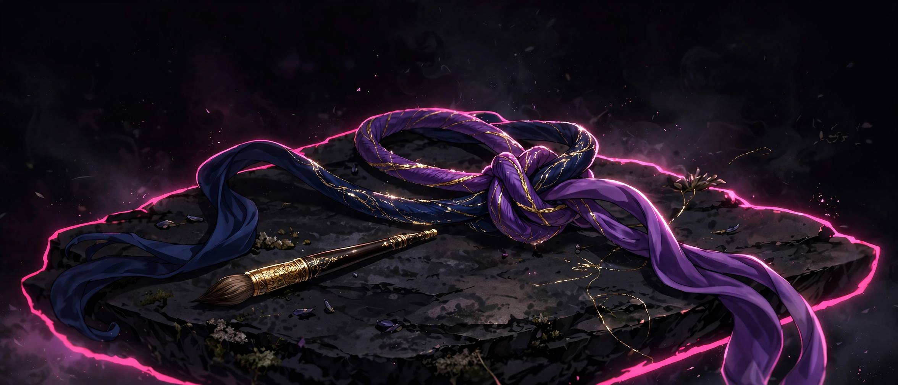

# Handfast

## 18+ — Adults Only

This game contains adult content. It is intended only for players 18 and older. An 18+ gate with content warnings comes first — nothing starts, and no sound plays, until you enter.

### Content notes

- Sustained hand-to-body touch between two adult women is the central mechanic
- A held-gaze sequence, where resting your gaze on her fills a regard meter
- At the peak of her regard, her eyes glow — this effect can be turned off in Settings

All characters depicted are adults.

## A two-character touch game where you guide Prima's hand onto Sloane's body and keep contact while you hold her gaze.

<a href="https://github.com/NTRanch/handfast">GitHub</a> · <a href="https://github.com/NTRanch/handfast/blob/main/LICENSE.md">License</a> · <a href="https://ntranch.itch.io">itch.io studio page</a>

## Built with

 

## What you do

Your hand is Prima's. You bring it to Sloane's body and press — mouse down or Space — when the ring marking the spot glows, to plant the hand there. Once planted, the hand is carried by Sloane: it rides her breathing body and cannot drift.

From there you keep the planted hand travelling along a guided path across her body. Straining too far for too long breaks contact, and three breaks end the scene. The final stage is stillness instead of movement: rest your gaze on the pulsing point until the regard meter fills — the longest hold in the game, against her deepest breathing.

## Features

- Three levels tracing a path across her body: First Touch (hip to heart), The Brush's Path (hip to shoulder to cheek), and Held Appraisal (shoulder to heart to cheek)
- A planted hand that rides her breathing, with a strain limit — half a second past the line breaks contact, and three breaks end the beat
- Settings for calm mode (reduced secondary motion), the eye-glow effect, and sound; progress and best scores persist in the browser

## Media

- [Level 1 preview](../docs/previews/level-1-handfast.mp4)
- [Level 2 preview](../docs/previews/level-2-handfast.mp4)
- [Level 3 preview](../docs/previews/level-3-handfast.mp4)

## Controls

| Action | Keys |
| --- | --- |
| Plant / press the hand | Mouse down or Space |
| Move the hand in play | Arrow keys |
| Work the menus | Arrow keys + Enter |
| Pause | Esc or P |

## Status

**v1.0.0** — complete. Built for the Torogao Jam Program (a 14-week, one-game-per-week programme) for the Gameotron jam on itch.io. This GitHub page is the game's home while itch project slots are unavailable. To play, open `web/index.html` in a browser — it is one self-contained file and needs no server, no assets, and no network. Free to play.

## Credits

A Nice Thoughts Ranch game.

Made with Rust.
